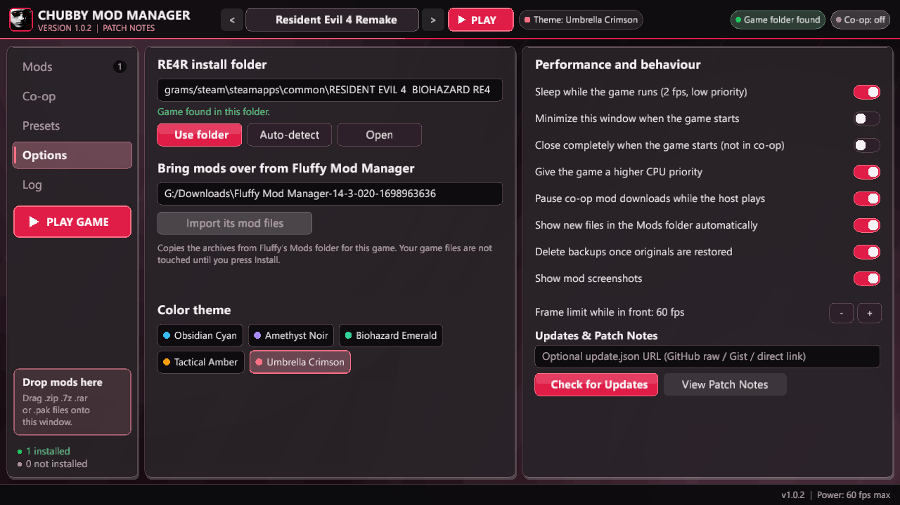

# Chubby Mod Manager

  <b>A modern, high-performance Mod Manager for Resident Evil games bundled RE4R Multiplayer Enhanced Mod , REFramework.</b>

  
  

---

## ⚡ Highlights & Features

- **🎮 One-Click Game Launch (`▶ PLAY`)**: Instantly launch your selected Resident Evil game via Steam or executable directly from the manager.
- **🧟 RE4R Multiplayer (Chubby Enhanced)**: Comes bundled with the enhanced Resident Evil 4 Remake Co-op mod:
  - **Single OS Mouse Cursor Fix**: Eliminates the annoying double-cursor bug when clicking in-game menus.
  - **Smooth 60 Hz Enemy & Partner Animation**: No more 10-20 FPS choppy zombie animations on partner screens.
  - **Immersive In-Game Menu**: Upper-right "Co-op" button smoothly auto-hides during gameplay when not hovered.
  - **Non-Blocking Menus**: Opening inventory or pause menu no longer freezes gameplay for your partner.
  - **Live REFramework & Co-op Theme Sync**: In-game REFramework (`dinput8.dll`) and Co-op menus automatically synchronize colors and modern rounded borders to your chosen theme.
  - **Quick REFramework Toggle**: Open REFramework instantly in-game using `Fn + 5` (`F5`).
- **🎨 5 Stunning Built-in Themes**: Switch on the fly between *Umbrella Crimson*, *Obsidian Cyan*, *Biohazard Emerald*, *Amethyst Noir*, and *Tactical Amber*.
- **🤝 (Soon)P2P Co-op Mod Syncing**: Host a session and friends can automatically download and sync matching mod lists directly with you.

---

## 📸 Screenshots

### Mod Library & Active Manager

  

### Co-op Host & Network Center

  

### One-Click Update & Hotfix Release Notes

  

### Manager Configuration & Performance Settings

  

---

## 🎨 Themes Showcase

Chubby Mod Manager features 5 live-switchable themes that synchronize dynamically with your in-game menus:

| Umbrella Crimson | Obsidian Cyan |
| :---: | :---: |
|  |  |

| Biohazard Emerald | Amethyst Noir |
| :---: | :---: |
|  |  |

| Tactical Amber |
| :---: |
|  |

---

## 📥 Installation

1. Download **[Chubby_Mod_Manager_Setup.exe](https://github.com/iiEKiLLeR/chubby-mod-manager-releases/releases/latest/download/Chubby_Mod_Manager_Setup.exe)**.
2. Run the installer and select your preferred destination folder (or keep the default).
3. Click **Install**. A desktop shortcut and Start Menu entry will be created.
4. Launch the manager, enable your mods, and press **PLAY**!

---

## 🔁 Automatic Updates

You never have to manually reinstall to receive updates:
- Chubby Mod Manager automatically checks GitHub on startup.
- When an update or hotfix is published, a release modal with full patch notes appears.
- Click **Update** to download and hot-swap the new version seamlessly without losing any mods, presets, or settings.
