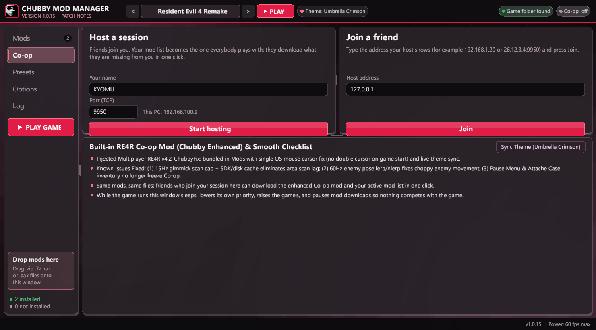
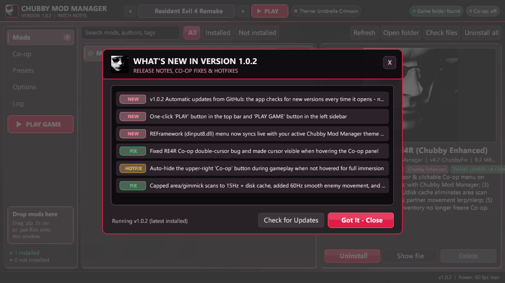
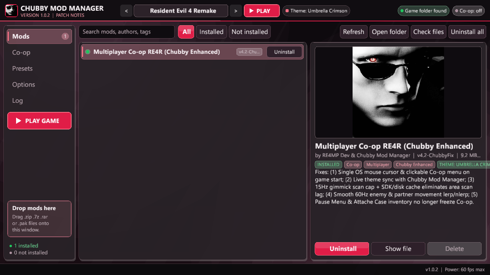
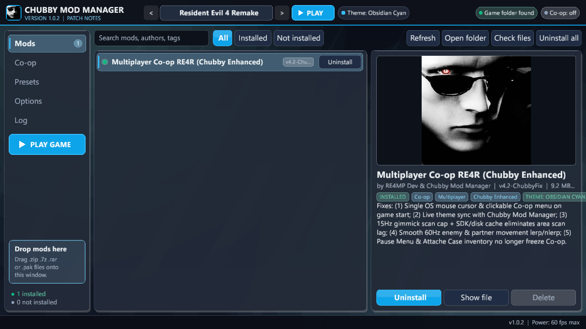
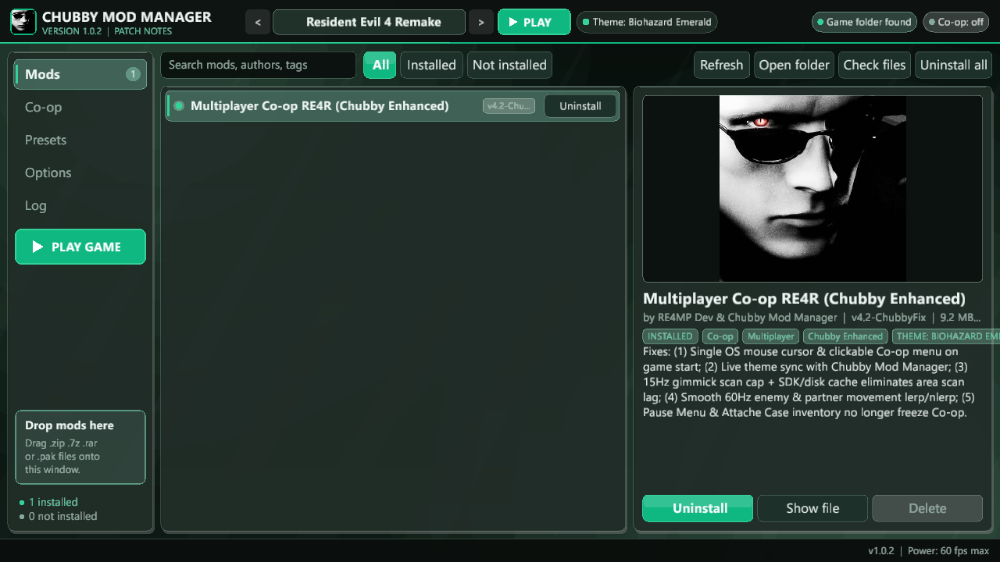
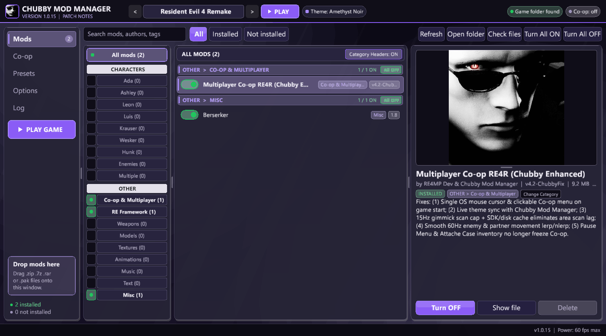
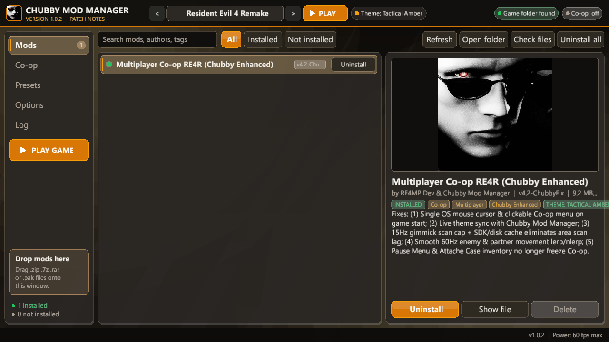

# Chubby Mod Manager

  <b>A modern, high-performance Mod Manager for Resident Evil games bundled with RE4R Multiplayer Enhanced Mod & REFramework.</b>

  
  

---

## ⚡ Highlights & Features

### 📂 Smart Category Navigator
Keep your entire mod library organized and accessible with dedicated **CHARACTERS** and **OTHER** categories.

- **Character Categories:** Leon, Ada, Ashley, Luis, Claire, Jill, Wesker, and more.
- **Mod Categories:** Co-op & Multiplayer, REFramework, Weapons, Models, Textures, Animations, Music, and Miscellaneous.
- **Live Status Indicators:** Instantly see which categories contain active mods.
- **Mod Counts:** Track the number of mods in each category.
- **One-Click Reassignment:** Easily move mods between categories.

### 🟢 Instant Mod & Category Control
Take complete control of your mod library with fast, one-click toggles.

- Enable or disable individual mods instantly.
- Turn entire categories **ON or OFF** at once.
- Use **Turn All ON / Turn All OFF** to control your entire mod collection.
- Manage large mod libraries without manually toggling each mod.

### 📐 Fully Customizable Workspace
Make the manager work the way you want.

- Resize panels by dragging dividers across the Sidebar, Category Navigator, Mod List, Mod Details & Preview, Co-op Center, and Options.
- Customize your workspace to fit your preferred workflow.
- **Automatic Layout Saving:** Your panel sizes and workspace arrangement are saved automatically and restored the next time you launch the manager.

### 🎮 One-Click Game Launch
Skip the extra steps and jump straight into the game.

- Launch your selected Resident Evil title directly from the manager.
- Supports launching through **Steam or the game's executable**.
- Start your game without leaving the application.

### 🧟 Resident Evil 4 Remake Multiplayer — Chubby Enhanced
A bundled, enhanced version of the RE4 Remake Co-op mod, featuring quality-of-life improvements and a more polished multiplayer experience.

- **Live Theme Synchronization:** REFramework (`dinput8.dll`) and Co-op menus automatically match your manager's selected theme, including colors and modern rounded borders.
- **Quick REFramework Access:** Open REFramework instantly in-game using **F5 (Fn + 5)**.

### 🎨 Five Premium Built-in Themes
Give your manager a look that matches your style with five carefully designed themes.

- 🔴 **Umbrella Crimson**
- 🔵 **Obsidian Cyan**
- 🟢 **Biohazard Emerald**
- 🟣 **Amethyst Noir**
- 🟠 **Tactical Amber**

Switch between themes instantly and enjoy a consistent visual experience throughout the manager and supported in-game interfaces.

### 🤝 (Coming Soon)P2P Multiplayer Mod Synchronization
Make playing together easier with built-in peer-to-peer mod synchronization.

- Host your own multiplayer session.
- Let friends connect directly to your session.
- Automatically share and download matching mod lists.
- Keep everyone's mod setup synchronized for a smoother multiplayer experience.

**One manager. Your entire mod library. A better way to play Resident Evil.**
---

## 📸 Screenshots

### Mod Library, Category Navigator & Active Toggles

  

### Co-op Host & Network Center

  

### Manager Configuration & Options

  

### What's New & Patch Notes Modal

  

---

## 🎨 Themes Showcase

Chubby Mod Manager features 5 live-switchable themes that synchronize dynamically with your in-game menus:

| Umbrella Crimson | Obsidian Cyan |
| :---: | :---: |
|  |  |

| Biohazard Emerald | Amethyst Noir |
| :---: | :---: |
|  |  |

| Tactical Amber |
| :---: |
|  |

---

## 📥 Installation

1. Download **[Chubby_Mod_Manager_Setup.exe](https://github.com/iiEKiLLeR/chubby-mod-manager-releases/releases/latest/download/Chubby_Mod_Manager_Setup.exe)**.
2. Run the installer and select your preferred destination folder (or keep the default).
3. Click **Install**. A desktop shortcut and Start Menu entry will be created.
4. Launch the manager, toggle your mods **ON**, and press **PLAY**!

---
